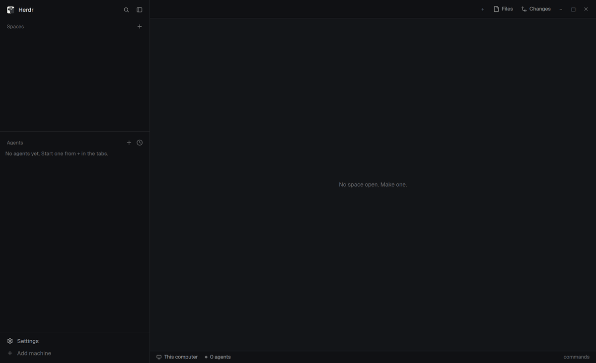

# wrangler

Projects, git worktrees and coding agents for the [Herdr](https://herdr.dev) desktop app.

Made for anyone coming from the herdr TUI or tmux who wants the same keyboard-first flow in the app: a prefix key, then a single key for tabs, panes, spaces, projects and agents, with a panel showing what's available. Projects and the agent sidebar take their cue from [T3 Code](https://github.com/pingdotgg/t3code): repos saved as projects that reopen the way you left them, a New agent dialog that can put each agent in its own worktree, and a sidebar showing each agent's project, task and branch at a glance.



**[Getting started](docs/getting-started.md)** walks through every feature with screenshots.

## Features

- **Projects** that reopen with their saved tabs, splits and programs.
- **Worktrees** from HEAD or any remote branch, nested under their project in the Spaces list.
- **New agent** dialog: any installed agent (Claude, Codex, OpenCode, ...), in the project folder or a fresh worktree.
- **Auto-named branches**: Claude's first prompt turns a temp `wr/…` branch into `feat/…`, `fix/…`.
- **Agent switcher** with a live preview, the agents that need you first.
- **Prefix keys** (optional), which-key style.

## Requirements

- [Herdr desktop app](https://herdr.dev) 0.1.11 or newer (`herdr-app` and `hc` on your PATH)
- git 2.31+, bash, jq
- `claude` CLI, optional, for branch names
- Linux (macOS untested, Windows unsupported)

## Install

```sh
git clone https://github.com/imsalik/wrangler ~/code/wrangler
cd ~/code/wrangler
./install.sh                 # or: ./install.sh --no-prefix
herdr-app do layout.switch '{"name":"wrangler"}'
```

`install.sh` symlinks the mods and layout into `~/.config/herdr-app` (or `$HERDR_APP_HOME`) and backs up anything in the way. Keep the clone where it is, and rerun the script after moving it. `ctrl-shift-l` switches back to your own layout.

## Keys

`install.sh` never edits your `keys.json`. Copy what you want from [`keys.json`](keys.json):

| Key | Does |
|---|---|
| `ctrl-a` | prefix |
| `ctrl-shift-j` | projects picker |
| `ctrl-shift-g` | New agent |
| `ctrl-shift-a` | agent switcher |
| `ctrl-alt-a` | sends a real `ctrl-a` to the terminal |

The prefix is whichever key you bind to `mod.open:prefix`. Leave it unbound (or install with `--no-prefix`) to go without. After the prefix:

| Key | Does |
|---|---|
| `a` | agent switcher |
| `⇧O` | projects picker |
| `⇧A` | New agent |
| `g` | new worktree |
| `⇧S` | save layout to the project |

Herdr's own commands are there too: tabs `c n p 1-9`, panes `; " hjkl z x`, spaces `o ⇧N ⇧W ⇧D`, and `?` for all keys.

## Configuration

Optional, in `~/.config/herdr-app/data/`:

- `projects/projects.json`: your projects, plus `settings` for the worktree folder, temp branch prefix, remote and branch naming.
- `prefix/config.json`: the prefix panel (`"show": "side" | "top" | "hint" | "off"`), your own groups, rebinding keys.

Everything is described in the **[reference](docs/reference.md)**, along with every `projects.*` command.

## Uninstall

```sh
cd ~/.config/herdr-app
rm mods/{projects,projects-ui,my-spaces,my-agents,prefix} layouts/wrangler.json layouts/wrangler-preview.svg
```

Switch layouts first (`ctrl-shift-l`) and remove wrangler's lines from `keys.json`. Worktrees are plain git worktrees.

## Limitations

- Branch renaming works with Claude only, for projects on this computer.
- `my-spaces` and `my-agents` are copies of Herdr's `spaces` and `agents` mods and won't pick up Herdr's later changes to them.
- Saving a layout uses an undocumented Herdr API that may change.

## License

[MIT](LICENSE)
