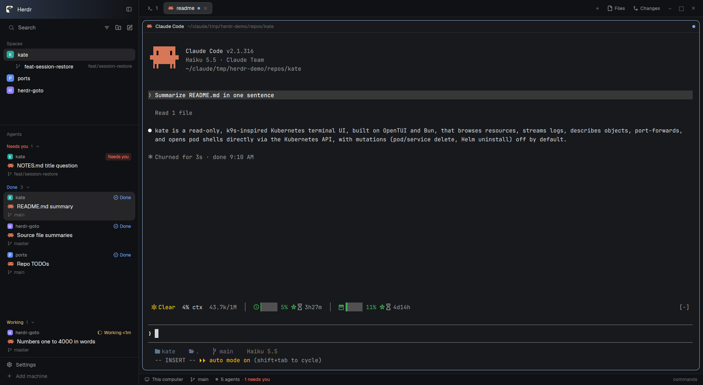

# wrangler

T3 Code style agent threads for the [Herdr](https://herdr.dev) desktop app, built on Herdr's own spaces. Working agents keep going in the background while the ones that need you rise to the top.

Made for anyone coming from the herdr TUI or tmux who wants the same keyboard-first flow in the app: a prefix key, then a single key for tabs, panes, spaces, projects and agents, with a panel showing what's available. Projects and the agent sidebar take their cue from [T3 Code](https://github.com/pingdotgg/t3code): repos saved as projects that reopen the way you left them, a New agent dialog that can put each agent in its own worktree, and a sidebar showing each agent's project, task and branch at a glance.



**[Getting started](docs/getting-started.md)** walks through every feature with screenshots.

## Features

- **Projects** that reopen with their saved tabs, splits and programs.
- **Worktrees** from HEAD or any remote branch, nested under their project in the Spaces list.
- **New agent** dialog: any installed agent (Claude, Codex, OpenCode, ...), in the project folder or a fresh worktree.
- **Auto-named branches**: Claude's first prompt turns a temp `wr/…` branch into `feat/…`, `fix/…`.
- **A tidy sidebar**: worktrees fold under their project, other machines get one row each, and each list's header has a search button for its picker.
- **Agents list** sorted by who's waiting: Needs you, Done and Idle on top with how long ago they stopped, Working pinned at the bottom with how long it's been running. Hover an idle agent to close it.
- **Agent switcher** with the agents that need you first, and a peek at any of them without leaving where you are.
- **Conversation history**: every past Claude conversation, newest first, searched by title (fuzzy) or inside your own messages and filtered by project, worktrees included. Enter resumes it with `claude --resume`, in its folder (or its project's, when a worktree is gone).
- **Prefix keys** (optional), which-key style.

## Requirements

- [Herdr desktop app](https://herdr.dev) 0.1.11 or newer (`herdr-app` and `hc` on your PATH)
- git 2.31+, bash, jq
- `claude` CLI, optional, for branch names
- Linux (macOS untested, Windows unsupported)

## Install

```sh
git clone https://github.com/imsalik/wrangler
cd wrangler
cp -r mods/* ~/.config/herdr-app/mods/
cp layouts/* ~/.config/herdr-app/layouts/
herdr-app do layout.switch '{"name":"wrangler"}'
```

Plain Herdr mods and a layout: copy them into your Herdr home (`$HERDR_APP_HOME` if you set one) however you like. Skip `mods/prefix` if you don't want the prefix. Check first that none of the names are taken (`projects`, `projects-ui`, `my-spaces`, `my-agents`, `prefix`, `wrangler.json`). To update, pull and copy again. `ctrl-shift-l` switches back to your own layout.

## Keys

Nothing is bound for you. Copy what you want from [`keys.json`](keys.json) into `~/.config/herdr-app/keys.json`:

| Key | Does |
|---|---|
| `ctrl-a` | prefix |
| `ctrl-shift-j` | projects picker |
| `ctrl-shift-g` | New agent |
| `ctrl-shift-a` | agent switcher |
| `ctrl-shift-enter` / `ctrl-shift-q` | in a peek: go to the agent / close the peek |
| `ctrl-alt-a` | sends a real `ctrl-a` to the terminal |

The prefix is whichever key you bind to `mod.open:prefix`. Leave it unbound (or don't copy `mods/prefix`) to go without. After the prefix:

| Key | Does |
|---|---|
| `a` | agent switcher |
| `r` | resume a past Claude conversation |
| `⇧O` | projects picker |
| `⇧A` | New agent |
| `g` | new worktree |
| `⇧S` | save layout to the project |

Herdr's own commands are there too: tabs `c n p 1-9`, panes `; " hjkl z x`, spaces `o ⇧N ⇧W ⇧D`, and `?` for all keys.

## Configuration

Optional, in `~/.config/herdr-app/data/`:

- `projects/projects.json`: your projects, plus `settings` for the worktree folder, temp branch prefix, remote and branch naming.
- `projects/history-ignore`: folders whose Claude conversations never show in the history, one per line (`~` allowed).
- `prefix/config.json`: the prefix panel (`"show": "side" | "top" | "hint" | "off"`), your own groups, rebinding keys.

Everything is described in the **[reference](docs/reference.md)**, along with every `projects.*` command.

## Uninstall

```sh
cd ~/.config/herdr-app
rm -r mods/{projects,projects-ui,my-spaces,my-agents,prefix} layouts/wrangler.json layouts/wrangler-preview.svg
```

Switch layouts first (`ctrl-shift-l`) and remove wrangler's lines from `keys.json`. Worktrees are plain git worktrees.

## Limitations

- Branch renaming works with Claude only, for projects on this computer.
- `my-spaces` and `my-agents` are copies of Herdr's `spaces` and `agents` mods and won't pick up Herdr's later changes to them.
- Saving a layout uses an undocumented Herdr API that may change.
- The history reads Claude Code's own transcripts (`~/.claude/projects`), an internal format that may change. Conversations on this computer only.

## Credits

This project is developed and maintained by [Claude](https://claude.com/claude-code), Anthropic's AI coding agent.

## License

[MIT](LICENSE)
