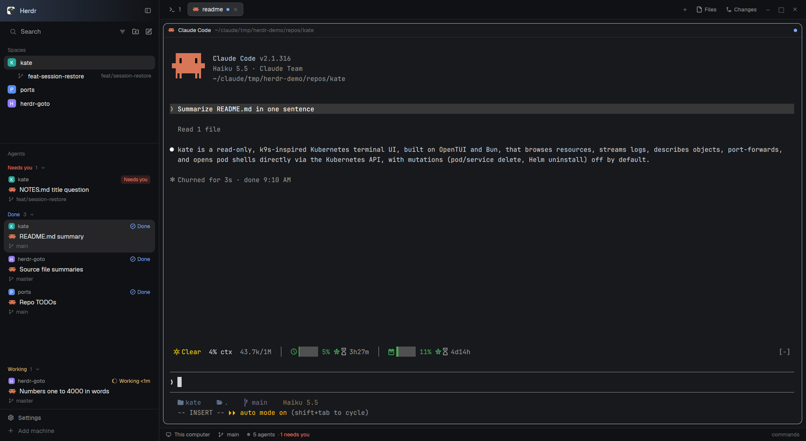

# wrangler

A Herdr window for working on several repos with coding agents. On the left, a Spaces list where worktree spaces sit under their repo, and an Agents list where each agent shows its project, Claude's current task and its branch. The Spaces `+` opens a menu of saved projects (open one with its saved tabs and splits, or start a worktree from it); the Agents `+` opens a "New agent" dialog that starts an agent in a project's folder or in a fresh worktree. A switcher popup lists every agent, the ones that need you first, with a live preview of the selected one's screen. A which-key prefix shows every key while it waits for one. Worktrees started without a branch name get a temp branch that Claude's first prompt renames.



## What you see

Left to right, a row on the `canvas` background, no title bar (`"titlebar": "none"`, traffic lights at `[12, 16]`), 1px `border` dividers, terminal padding `[14, 12]`. No theme of its own: it uses the person's theme.

**Sidebar**, 342px (min 44, max 480, not resizable), background `chrome`, a column:

1. **Brand**, 46px: the shipped `workspace-chrome` mod, drags the window.
2. **Spaces** (weight 0.854, min 90). A 31px header: "Spaces" at 11.5px `dim`, a 26px `+` button on the right. Rows 30px, rounded 8, `selected` when active, `hover` otherwise. Each row: an 18px avatar (rounded 5, the space's first letter, white bold 10.5px) in one of `#22a99a`, `#e3814f`, `#5b8def`, `#8b7cf6`, `#3fae6a`, `#d9649a` (assigned least-used first, kept in shared `space.colors`), the name (max 150px) and, right-aligned at 11.5px `dim`, `repo · branch` only where unusual (main and master hidden, repo hidden when the name says it), then `↑n` in `ansi2` and `↓n` in `ansi1`. A worktree space is a 28px row under its main checkout's row, indented 22px with a 13px `branch` icon instead of the avatar. With other machines known, rows group under a 26px header per machine ("This computer", a `+`, a connected dot in `ansi2`, a fold chevron).
3. **Agents** (weight 1.546, min 90), top border `border`. A 41px header: "Agents" at 11.5px `dim`; on the right a 14px `+` (tooltip "New agent") and a sort button (Priority or Grouped by space). Rows grouped under 30px section headers (Needs you, Done, Working, Idle; or one per space). Each agent row:
   - Top line 30px: for an agent in a saved project, a 13px badge (rounded 4, first letter, 8.5px bold white, the project's color) and the project name; otherwise the space name. Then sub-agent fold chevron, the program icon (16px), the time since its state changed (11px `dim`, a pin button on hover), and the status mark.
   - For Claude, its terminal title (the current task) on a line under it, 12px in `ansi5`.
   - For a project agent, a branch line at 11.5px `dim`: an 11px `git-branch` icon in `accent` for a linked worktree, or `branch` in `dim` for the main checkout, then the branch (the folder name when detached).
   - Sub-agents under it at 26px, indented 39px with tree lines.
4. **Footer**, 69px: `workspace-chrome` with `{ "footer": true }`.

**Work column** (not resizable):

1. **Tabs**, 42px: the shipped `tabs` mod, drags the window.
2. **Body**, a row with padding 8 and gap 8:
   - **Main**: the active tab. Panes have a 30px `pane` header always on top, `background` fill, 1px `border` border, 1px `accent` when focused, radius 10, gap 8, `lone: true`.
   - **Panel**, hidden, 499px (min 280, max 900): a stack of `files` and `changes`, `changes` active.
3. **Status**, 28px: `workspace-status`.
4. **Projects host**, 0px: draws nothing.

**Popups** (all from `projects-ui`, background `popover`):

- Spaces `+` menu, 290 x 560: "Empty space", a rule, a "Projects" heading, up to 8 project rows (scrolls with the wheel; each a badge, the name, a dim summary like "2 tabs" or "3 panes", a 22px branch button on the right), a rule, "Save this space's layout to <project>" (greyed when the focused space isn't a project), "Add project…", "Add current space as project". Rows 31px, rounded 7, 12.8px text, 14px icons.
- Space right-click menu, 340 x 260. Agent right-click menu, 280 wide, height 32 + 31 per row (+40 for the delete row): the folder as a dim heading, then the rows.
- Projects picker, 560 wide, 0.6 of the window tall, 40px from the top: title "Projects" 15px semibold, a 36px search field with an `accent` border, 32px rows (badge, name, folder, layout summary), then "Add current space as project" and "Add folder…", and a hint line "↵ open · tab new worktree".
- New agent, a 560 dialog: title "New agent". Rows with 54px captions: Project (a 466px dropdown), Where (a two-segment toggle "This folder" / "New worktree") with a 150px Agent dropdown to its right, and for New worktree also Branch (placeholder "optional: auto-named if empty") and From. A dim hint line says what Open will do (for example "~/code/myapp, its open space, Claude in a new tab"). Errors in `blocked`. Footer: key hints at 11px, Cancel, and a solid Open button.
- New worktree, a 520 dialog: "New worktree of <project>", Branch and From, a note ("New branch at …", "Branch exists: checks it out at …", "Worktree exists: opens …"), Cancel and Create.
- Delete worktree, a 460 dialog: "Delete worktree <branch>?", what it closes and removes, a red warning with the count of uncommitted changes, Cancel and a `blocked` Delete (or Force delete) button.
- Agent switcher, 820 x 500, 40px from the top: a 36px search field ("Switch to an agent…", the agent count on the right); a list of 32px rows (up to 12 shown): a row number 1-9, status mark, project badge (else the space's avatar color), name (max 150), task in `muted`, branch with icon (max 150), age or "here". To the right a 380px preview card: a 34px header (program icon and name, the status word, branch, folder) over the last 60 lines of the terminal in the app's monospace font at 11px `muted`. Footer hints: "↵ go", "⇧↵ peek", "1-9 jump", "^o preview", "esc".

**Prefix** (`prefix` mod): a frameless overlay over the whole window. Default "side": a 290px card in the bottom right (14px margin), rounded 10, `popover`, monospace 12px: an `accent` pill with the bound prefix key (from `keys.json`, else "prefix"), then 21px lines: group titles uppercase 10.5px `dim`, items as the key (46px, `accent`), "→", and the label. Footer "esc close" (and "^d/^u scroll" when it scrolls). "top": a grid up to 1000px (never wider than the window) at the top with groups as columns and 20px keycaps. "hint": only the "<key> prefix" tag.

## How it behaves

**Agent status**, in the switcher and the Agents list:

- working: a 12px `spinner.svg` in `working`, spinning every 900 ms.
- blocked: "Needs you" pill (18px, `blocked` text on `blocked` at alpha `26`), or a 14px "!" box where space is short (priority sections, the switcher). The switcher's preview says "needs you".
- done: a 7px `done` dot ("finished").
- idle: a 7px ring, 1.5px `idle` border.
- Sub-agents without a pane: `error` shows as blocked, `done` as idle.

**Spaces list.** Click selects, drag reorders, right-click opens the projects menu for that row:
- main checkout: Rename, New worktree, Open worktree (the shipped `worktree` dialog), Close;
- linked worktree: Rename, New worktree from this branch, Remove worktree (`worktree` dialog), Close;
- not in git: Rename, Close;
- plus "Add as project" when the repo (or folder) isn't saved.

The `+` opens the projects menu. Clicking a project opens it: its open space is selected, or a new space is built from its saved layout (tabs, splits, weights, programs, mod panes). The branch button opens New worktree; hovering a project shows an x that opens a "Remove <name>?" confirm dialog (Cancel / Remove, Enter removes, Esc closes; files stay); right-click on a project opens its project menu (Open, Open new space anyway, Open in new worktree, Save layout here, Clear layout, Remove project). ↑↓ Enter Esc work, and Tab or ctrl-Enter runs the row's branch button.

**Agents list.** Click focuses the agent. Right-click opens Copy branch, Copy path and, in a linked worktree, Delete worktree…. The `+` opens New agent.

**New agent.** Project defaults to the focused space's saved project. Tab / shift-Tab move between fields; ←→ or Space flips Where; ↓ or Space opens a dropdown, where typing filters, ↑↓ move, Enter or Tab picks, Esc closes the list. Enter (or ctrl-Enter) starts; Esc cancels. The From list is "Current HEAD · <branch> @ <sha>" then `origin/*` newest first, each with its age, the project default marked "default". "Add project…" or "Add current space as project" from the Project list adds it and selects it. While working the footer shows a spinner and stage ("Fetching origin/main…", "Creating worktree…", "Opening space…", "Starting claude…"); the dialog closes when done.

- This folder: selects the project's open space and adds a tab running the agent, named after it. With no space open, it builds one from the layout and uses the layout's first pane running that agent, else adds the tab.
- New worktree: makes the worktree (remote base fetched, `--no-track`), opens it in a new space with the project layout; the agent is the layout's first pane running it, else a new tab. An empty Branch gets `<branchPrefix>/<8 hex>` (default prefix `wr`), marked with git config `branch.<name>.wranglerTemp true`; only marked branches are renamed.

**Temp branch rename.** On Claude's first real prompt in that worktree (not empty, not starting with `/`), the branch becomes `<type>/<slug>` from the naming model (default `haiku`; the shipped prompt allows `feat`, `fix`, `chore`, `refactor`, `docs`, `test`, `poc`, any lowercase type is accepted; `-2`, `-3` on a clash), and the space is renamed to it if it still had the temp name or folder name. The folder keeps its name.

**Delete worktree.** Only a click on the button deletes. It closes the spaces in the worktree, kills terminals left in it, runs `git worktree remove` (`--force` only as Force delete), then `git worktree prune`. The branch stays.

**Switcher.** Order: blocked first, then most recently focused (a 250 ms poll of focus, 50 kept, saved in localStorage), the focused agent last as "here". It opens on the previous agent, so open + Enter flips between two. Typing filters (space-separated words, each a subsequence of project, space, task, branch, program and sub-agent names); ↑↓, ctrl-j/k, ctrl-n/p move; Enter focuses (`agent.focus`), shift-Enter peeks (`terminal.peek`); 1-9 with an empty filter jump; Backspace, ctrl-w, ctrl-u delete a char, a word, all; ctrl-o hides the preview; Esc closes. The preview rereads the screen every second. `projects.switch-last` flips without the popup.

**Prefix.** Bound by the person (for example `"ctrl-a": "mod.open:prefix"`). The next key runs its action and closes it; any unbound key, Esc or a click cancels. ctrl-d / ctrl-u and the wheel scroll the side panel when it's taller than the window. Its keys: Projects `a` switcher, `⇧O` picker, `⇧A` New agent, `g` new worktree, `⇧S` save layout; Tabs `c n p , 1-9 ⇧X`; Panes `; " hjkl ⇧←↓↑→ z x`; Spaces `o ⇧N ⇧W ⇧D`; App `b ⇧H s ? d`.

**What moves.** A new worktree space appears under its main checkout (it waits up to 1.5 s for its git before showing). Branch and ahead/behind update after a command or an agent turn ends and every 60 s while the window is in front. A renamed temp branch shows in the Agents branch line and the space name.

## Built from

**Layout `layouts/wrangler.json`** (`"preview": "layouts/wrangler-preview.svg"`, cloned from `main` 0.1.7):

```
root row (background canvas)
├─ sidebar column 342px, min 44, max 480, background chrome, resizable false
│  ├─ brand        block  workspace-chrome                 46px, window_drag
│  ├─ sidebar-lists column
│  │  ├─ spaces    block  my-spaces                        weight 0.854, min 90
│  │  └─ agents    block  my-agents                        weight 1.546, min 90
│  └─ sidebar-footer block workspace-chrome {footer: true} 69px
└─ work column, resizable false
   ├─ tabs         block  tabs                             42px, window_drag
   ├─ work-body    row, padding 8, gap 8
   │  ├─ main      block  {tab: "active", pane: {header: pane mod, reveal always, 30, top; radius 10; gap 8; lone}}
   │  └─ panel     column 499px, min 280, max 900, hidden
   │     └─ panel-body stack (files, changes), active changes
   ├─ status       block  workspace-status                 28px
   └─ projects     block  projects {view: "host"}          0px
```

**Mods:**

- `projects` (`place: none`): the host. Lives in the 0px block, renders an empty `div`, and takes every `projects.*` command from `nextCommand()`: `pick`, `switch`, `switch-last`, `compose[:id[|where[|pick]]]`, `agent-start:<json>`, `branch-name:id|prompt[|model[|timeout]]`, `new-menu`, `space-menu:id[|main|plain]`, `row-menu:id`, `add-space:id`, `agent-menu:term`, `agent-copy:term|branch|path`, `agent-delete:term`, `wt-delete:term[|force]`, `add-folder`, `wt-from:spaceId[|branch[|base]]`, `save[:id]`, `add[:folder]`, `menu:id`, `open:id`, `open-new:id`, `clear:id`, `worktree[:id[|mode[|branch]]]`, `wt-create:id|branch[|base]`, `remove:id`, and overlay requests `overlay:<spec>`, `bases`, `wt-run`, `agent-run`, `agent-info`, `wt-delete-run`. `lib.js`: projects.json, layout capture and apply, checkouts, bases, worktrees. `agent.js`: agent argv from `knownAgents`, `--settings` for Claude, temp branch names, Haiku naming. `prefix.json`: its prefix group. `naming-prompt.txt`: the naming system prompt.
- `projects-ui` (overlay popup at top, offset 40, 560 x 0.6): only draws. `props.view` picks the view and the file it loads: `picker`, `new`, `menu`, `space-menu`, `agent-menu` (`menus.js`), `worktree`, `agent-delete` (`worktree.js`), `compose` (`compose.js`), `switch` (`switcher.js`); shared helpers in `ui.js`. Reads the host's cache on `globalThis.__wranglerProjects` and sends `projects.*` commands; long work is a request with a `req` id whose `{stage, done, value, error}` the host publishes.
- `my-spaces`: a clone of shipped `spaces` 0.1.10. Edits marked `// personal:`: header `+` runs `projects.new-menu`; right-click runs `projects.space-menu:<id>` (plus `|main` for a main checkout) for a git row, else `projects.row-menu:<id>`.
- `my-agents`: a clone of shipped `agents` 0.1.7. Edits marked `// personal:`: the project badge and title, the branch line, the agent icon on the right, the `+` running `projects.compose`, right-click running `projects.agent-menu:<address>`. Reads `data/projects/projects.json` every 30 s; `props.sortMenu` draws the sort popup.
- `prefix` (overlay popup at top, offset 0, width 1, height 1, frame none): reads `mods/prefix/defaults.json`, every installed `mods/<name>/prefix.json`, and `data/prefix/config.json` (`show`, `defaults`, `groups`, `mods`) on each open; runs actions with `run(name, {firstArg: value})` using `commands()` for the argument name.

**Shipped mods it uses:** `workspace-chrome` (brand, footer and every icon: `mods/workspace-chrome/<name>.svg` for search, chevron-down, chevron-right, spinner, git-branch, branch, plus, folder, folder-plus, layers, minus, x, square-pen, server, monitor, pin, pin-off, check, clock), `tabs`, `pane`, `files`, `changes`, `workspace-status`, `worktree` (Open and Remove worktree, `props {space, action: "open" | "remove"}`), `picker` (prefix `o`).

**herdr functions:** `agents`, `terminals`, `spaces`, `panes`, `focused`, `machines`, `layout`, `window`, `run`, `commands`, `nextCommand`, `notify`, `openOverlay`, `closeOverlay`, `props`, `exec`, `hc`, `pickFolder`, `watchFolder`, `readTextFile`, `writeTextFile`, `appHome`, `home`, `knownAgents`, `shared`, `setShared`, `setAgentOrder`, `settings`, `theme`; `cx.bind_keys`, `cx.timer`, `cx.write_to_clipboard`, `localStorage`.

**Commands it runs:** `space.new`, `space.select`, `space.close`, `space.rename`, `space.move`, `tab.new`, `tab.select`, `tab.close`, `pane.split`, `pane.focus`, `terminal.open`, `terminal.kill`, `terminal.peek`, `agent.focus`, `layout.resize`, `mod.open`.

**Programs:** `git` (rev-parse, status, for-each-ref, worktree add/list/remove/prune, fetch, check-ref-format), `hc` (`read`, `get --json`, `run --bg`, `rm`, `kill`, `machine ls --json`, `connect` for `doc.get`), `claude -p --model <naming.model>` (exec's own time limit), `sh`, `readlink -f`, `mkdir`, `test`, `sleep`. The hook `hooks/rename-branch.sh` (bash) uses `git`, `jq`, `git hash-object` for lock keys, `timeout`/`gtimeout` or a kill fallback, `setsid` or `nohup`, `claude`, `herdr-app ls` and `herdr-app do space.rename`.

**Data:** `<app home>/data/projects/projects.json` (`{version: 1, settings?: {worktreeRoot, branchPrefix, remote, naming: {enabled, model}}, projects: [{id, name, folder, machine, defaultBase, branchPrefix?, worktreeRoot?, remote?, layout}]}`, watched), `<app home>/data/projects/claude-settings.json` (generated: a `UserPromptSubmit` hook to this checkout's script, timeout 5), worktrees at `<worktreeRoot, default ~/.herdr/worktrees>/<repo>/<branch with non [A-Za-z0-9._-] as ->`, the hook's log and locks in `${XDG_STATE_HOME:-~/.local/state}/wrangler/`.

**Art:** `layouts/wrangler-preview.svg` (320 x 200), the workspace-chrome icons above, `icons/claude.svg` for Claude in the agent list.

## Watch out

- **Overlays only draw.** Herdr keeps every overlay's modules in memory after it closes, so the host does the work and `projects-ui` loads only the file for its view. Lists build only their visible rows (a hand-rolled windowed list) instead of a virtual list, and cached values are reused when unchanged so closed overlays share one copy.
- **Re-rendering from a view.** A timer started inside a spawned task (a view's `start`) fires but can't re-render. `projects-ui/main.js` runs one 100 ms timer from `init` that calls the view's `tick`; views watch the cache's `ver` counter.
- **An overlay opened by a closing overlay doesn't show.** Menus route the next overlay through the host (`projects.overlay:<spec>`). For keys, bind `projects.*` commands, not `mod.open:projects-ui`.
- **Tab and Esc in dialogs.** Without `cx.bind_keys` for `tab`, `shift-tab`, `escape` in a `WranglerDialog` key context (actions `wrangler::Next`, `wrangler::Prev`, `wrangler::Back`), Tab leaves the dialog and Esc closes it from inside an open dropdown. Bind once (guarded by a global flag).
- **One host.** The 0px `projects` block is the only one. A second visible `projects` view makes every command run twice.
- **Layout capture is undocumented.** Splits and weights come from `doc.get` on `herdr-app` through `hc connect`. If that fails the save falls back to each tab's panes side by side and warns. Shells are saved as `argv: null`, other programs by their foreground argv; `cwd` is relative to the repo.
- **Building a saved layout** waits for each new space, tab and pane by polling (`until`: 60 tries, 50 ms apart, so 3 s) and fails with "The space didn't appear in time." A layout whose first pane is a mod gets a placeholder first tab that is closed afterwards. Weights are applied with `layout.resize` after building.
- **`exec` stops at 30 s.** A slow `git fetch` is retried as a hidden `hc run --bg` terminal, polled every 0.5 s for up to 5 minutes.
- **The hook is found through the symlink.** `agent.js` resolves `readlink -f <app home>/mods/projects` to find `hooks/rename-branch.sh`. Copying the folders (instead of `install.sh`'s symlinks) silently disables renaming. It is never used for projects on another machine.
- **The hook must print nothing** (stdout reaches Claude) and return at once: it detaches the work. It unsets `CLAUDECODE`, `CLAUDE_*` session variables and `HC_*` before the nested `claude -p`, or that run misbehaves. It only matches branches `^[A-Za-z0-9._-]+/[0-9a-f]{8}$`, so a `branchPrefix` with a `/` is never renamed. Once per worktree and branch (a lock dir per md5 of both).
- **Herdr doesn't watch symlink targets.** Editing the clone doesn't hot-reload; `touch -h` the link (install.sh does).
- **Clones go stale.** `my-spaces` and `my-agents` don't get Herdr's later fixes to `spaces` and `agents`; re-clone and re-apply the `// personal:` edits.
- **Limits:** branch names cut to 64 chars, slugs at most 5 words, naming timeout 20 s, prompt sent to the hook cut to 4000 chars, hook locks pruned after 30 days, tab titles from a prompt at most 28 chars, MRU 50 agents, 50 request states kept, menus show 8 rows, dropdowns 8 (Project 7, Agent 6), switcher 12 rows, preview 60 lines, bases refetched when older than 30 s, host warms caches every 2 s.
- **Assumes:** git with the configured remote (default `origin`; bases are `HEAD` or `<remote>/<x>`), `claude` on the PATH for naming, `jq` for the hook, the shipped mods listed above.

## Done when

- `herdr-app check` passes for `projects`, `projects-ui`, `my-spaces`, `my-agents`, `prefix`, and `layout.switch` to `wrangler` shows the sidebar, tabs, status bar and no visible projects block.
- Spaces `+` > Add current space as project in a repo adds it to `data/projects/projects.json` with `defaultBase` from `origin/HEAD`, and the project shows in the menu with a colored badge.
- Splitting that space and running a program, then prefix `⇧S`, toasts "Saved layout to <name>"; closing the space and clicking the project rebuilds the same tabs, splits and program.
- Prefix `g`, a branch name and an `origin/*` base makes `<worktreeRoot>/<repo>/<branch>` and opens it in a new space listed under the main checkout with a branch icon.
- New agent with New worktree and an empty Branch starts Claude on `wr/<8 hex>`; after the first prompt the branch, the space name and the Agents branch line change to a `<type>/<slug>` name.
- The Agents row for that agent shows the project badge and name, Claude's task in `ansi5`, and the branch with an `accent` `git-branch` icon.
- Right-click on that agent > Delete worktree… closes its space, removes the folder and keeps the branch; with an uncommitted change the button reads Force delete.
- Prefix `a` opens the switcher on the previously focused agent; Enter goes there; opening it again and pressing Enter goes back. A blocked agent sorts first with the "!" mark.
- Prefix shows the side panel with the Tabs, Panes, Spaces, App and Projects groups; `"show": "top"` in `data/prefix/config.json` switches to the grid on the next open, and `"mods": {"projects": {"a": null}}` removes Switch agent.
