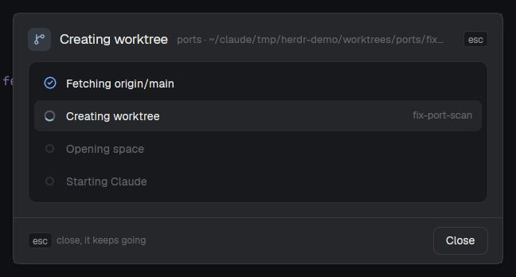

# Getting started

A walk through wrangler's main features, from your first project to running several agents side by side. For setup see the [README](../README.md#install); for every option see the [reference](reference.md).

Key names below assume the suggested [`keys.json`](../keys.json) bindings, with the prefix on `ctrl-a`.

## 1. Install and switch to the layout

```sh
git clone https://github.com/imsalik/wrangler
cd wrangler
cp -r mods/* ~/.config/herdr-app/mods/
cp layouts/* ~/.config/herdr-app/layouts/
herdr-app do layout.switch '{"name":"wrangler"}'
```

The sidebar has two lists: **Spaces** and **Agents**. The Spaces header has a search button (the projects picker, `ctrl-shift-j`) and a **+** for the new space / project menu; the Agents header has a search button (the agent switcher, `ctrl-shift-a`), the sort button and the pen for a new agent. A project with worktrees shows their count on the right (`2 ˅`): click it to fold them away (the one you're in stays). Once you have other machines, spaces group under a foldable row per machine, this computer first.

## 2. Add a project

A project is a repo (or any folder) wrangler remembers: its layout, its default base branch, its worktrees.

Open a space in your repo, then right-click it and pick **Add as project**:


Or use the new space menu (the **+** on the Spaces header): **Add project...** picks a folder, **Add current space as project** adds the one you're in. Once added, projects are listed in that menu with a colored badge:


Click a project to open it. Hover a project for an **x** that removes it from the list (after a confirm; your files, worktrees and branches stay). Right-click it for more: open in a new space, clear its saved layout. If a space is already open at that repo it's selected; otherwise a new one opens. `ctrl-shift-j` (or prefix `⇧O`) opens the same list as a picker you can type to filter.

**Save a layout.** Arrange a space the way you like (tabs, splits, an editor, a dev server), then pick **Save this space's layout to ...** from that menu, or press prefix `⇧S`. Next time the project opens, it opens like that.

## 3. Make a worktree

A worktree is a second checkout of the same repo on its own branch, so you (or an agent) can work on it without touching your main checkout.

Press prefix `g`, click the branch icon next to a project in that menu, or right-click a space and pick **New worktree**:


Type a **Branch** and pick **From**: the current HEAD or any remote branch (fetched first). **Create** makes the worktree under `~/.herdr/worktrees/<repo>/` and opens it in a new space, nested under its project in the Spaces list.

## 4. Start an agent

Click the pen on the Agents header, or press `ctrl-shift-g` (prefix `⇧A`):


- **Project:** defaults to the one you're in.
- **Where:** **This folder** adds a tab to the project's space. **New worktree** gives the agent its own worktree.
- **Agent:** any coding agent Herdr finds installed (Claude, Codex, OpenCode, ...).
- **Branch:** leave it empty and wrangler makes a temporary one.

Press `/` to jump to the Project list and type to filter it. Press **Open**: the dialog turns into a checklist of what it's doing (fetching the base, creating the worktree, opening the space, starting the agent). Close it any time; the work keeps going. If a step fails, the error shows under it and **Back** returns to the form.



Then give the agent its first message in the new tab.

## 5. Branches name themselves

With an empty Branch, a new worktree starts on a temp name like `wr/5d81d828`. When you send Claude its first prompt, wrangler asks a small model for a fitting name, renames the branch and the space, and leaves the folder where it is:


Each Agents row shows the project, what the agent is working on, and its branch. This needs the `claude` CLI; turn it off with `"naming": { "enabled": false }` in the [settings](reference.md#settings).

The Agents list (Priority sort, from the sort button on the Agents header) keeps the agents waiting on you at the top: **Needs you** first, then **Done**, then **Idle**, each with how long ago it stopped ("3m ago"). **Working** agents sit at the bottom with how long they've been running; it shows three, then an "N more" row. Hover an idle agent for an **x** that closes its pane (and its space, when that was the only pane there).

Claude keeps a conversation in its prompt cache for an hour after its last reply. In the last 10 minutes a waiting Claude agent shows an amber hourglass with the minutes left (and a toast if you're elsewhere); after that a blue **cold** snowflake. Opening a cooling or cold agent shows a popup (once while cooling, once more when cold) with how many tokens the next message re-sends. A session that hasn't sent anything yet shows a grey **draft** pencil instead of a time.


## 6. Switch between agents

Press `ctrl-shift-a` (prefix `a`). Agents that need you come first, then the ones you used most recently. Enter goes to one; shift-Enter peeks at it over the window, with **Go to** (`ctrl-shift-enter`) and **Close** (`ctrl-shift-q`) on its bar:


Type to filter, `1`-`9` to jump, Enter to go there. It opens on your previous agent, so the key then Enter flips between your last two.

## 7. Clean up

Right-click an agent row to copy its branch or path, or to delete its worktree:


**Delete worktree...** closes the worktree's spaces and terminals and removes the folder. The branch is kept, so nothing committed is lost. If there are uncommitted changes, you have to confirm with **Force delete**.

## 8. Prefix keys

Press the prefix (`ctrl-a` in the suggested keys) and a panel lists every key you can press next:


Press one to run it; Esc or any other key cancels. Don't want the panel? Set `"show": "hint"` or `"off"` in `data/prefix/config.json`. Don't want the prefix at all? Leave it unbound, or don't copy `mods/prefix`. See [Prefix](reference.md#prefix) to add your own groups or move keys.

## Next

- [Configuration](../README.md#configuration): worktree folder, branch prefix, remote, naming.
- [Reference](reference.md): every `projects.*` command, all settings, how renaming works, files written.
